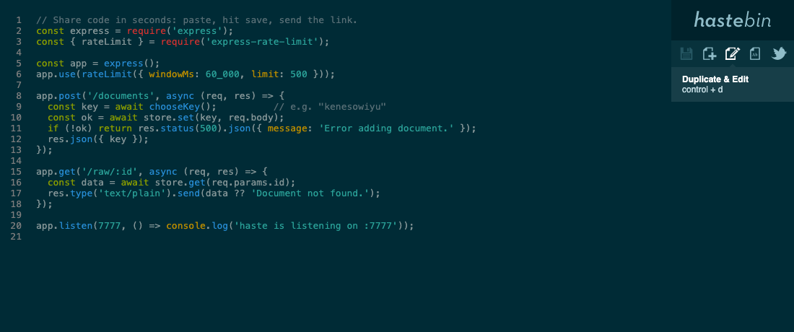

# Haste



Haste is an open-source pastebin server written in Node.js. It is easy to
install in any network and can be backed by the filesystem, Redis, Postgres or
Memcached.

Design objectives:

* Be really pretty
* Be really simple
* Be easy to set up and use

This is a maintained revival of the original
`seejohnrun/haste-server` (the software behind hastebin) by John Crepezzi,
which is no longer available on GitHub. Version 2 is a security-focused
modernisation; the UI, API and storage formats are unchanged, so it is a
drop-in replacement for existing installations (including the
`rlister/hastebin` Docker image).

## Usage

```sh
# from the console
cat something | curl --data-binary @- https://paste.example.com/documents
# => {"key":"abcdefghij"}

# multipart works too
curl -F data=@file.txt https://paste.example.com/documents
```

Clients built for hastebin such as
[haste-client](https://github.com/toptal/haste-client) keep working.

### API

| Method | Path              | Description                                   |
|--------|-------------------|-----------------------------------------------|
| POST   | `/documents`      | Body (raw or multipart field `data`) → `{"key"}` |
| GET    | `/documents/:key` | → `{"data", "key"}`                           |
| GET    | `/raw/:key`       | Plain text                                    |
| GET    | `/:key[.ext]`     | Web UI, `ext` selects syntax highlighting     |

## Running

### Docker

```sh
docker build -t haste-server .
docker run -d -p 7777:7777 -v haste-data:/app/data haste-server
```

or `docker compose up -d` with the included `docker-compose.yml`.

The container runs as the unprivileged `node` user (uid 1000).

### Node.js

Requires Node.js 22 or newer.

```sh
npm ci --omit=dev
npm start
```

## Migrating from `rlister/hastebin`

* Same port (7777), same working directory (`/app`), same data directory
  (`/app/data`) and the same environment variables, so you can swap the image.
* The file store keeps the original on-disk format; existing pastes remain
  readable.
* The old image ran as root, the new one does not. Fix ownership of an existing
  data volume once:

  ```sh
  docker run --rm -v <your-volume>:/data alpine chown -R 1000:1000 /data
  ```

  The server refuses to start with a clear error if it cannot write there.
* Behind a reverse proxy, set `TRUST_PROXY=1` so rate limiting sees real client
  IPs instead of the proxy's.

## Configuration

Settings come from `config.js` (JSON; override the path with `CONFIG_FILE`),
then environment variables. Old config files (winston array logging,
`connect-ratelimit` categories) are still understood.

| Setting           | Env var                         | Default         | |
|-------------------|---------------------------------|-----------------|---|
| `host`            | `HOST`                          | `0.0.0.0`       | |
| `port`            | `PORT`                          | `7777`          | |
| `keyLength`       | `KEY_LENGTH`                    | `10`            | |
| `maxLength`       | `MAX_LENGTH`                    | `400000`        | max paste size in characters (as in 1.x), `0` = unlimited |
| `staticMaxAge`    | `STATIC_MAX_AGE`                | `86400`         | seconds |
| `trustProxy`      | `TRUST_PROXY`                   | `false`         | Express [trust proxy](https://expressjs.com/en/guide/behind-proxies.html) value |
| `logging.level`   | `LOGGING_LEVEL`                 | `info`          | `error`, `warn`, `info`, `verbose`, `debug` |
| `logging.format`  | `LOGGING_FORMAT`                | `text`          | `text` or `json` |
| `keyGenerator`    | `KEY_GENERATOR_TYPE`, `KEY_GENERATOR_KEYSPACE`, `KEY_GENERATOR_PATH` | `phonetic` | see below |
| `rateLimits`      | `RATE_LIMIT_MAX`, `RATE_LIMIT_WINDOW_MS` | 500 / 60000 ms per IP | `RATE_LIMIT_MAX=0` disables |
| `storage`         | `STORAGE_*`                     | `file`          | see below |
| `documents`       | `DOCUMENTS=about=./about.md,...` | `about`        | static documents that never expire |

`RECOMPRESS_STATIC_ASSETS`, `LOGGING_TYPE` and `LOGGING_COLORIZE` from the old
image are accepted and ignored.

### Key generators

* `phonetic` (default) – pronounceable keys like `kenesowiyu`
* `random` – characters from `keyspace` (default `A-Za-z0-9`)
* `dictionary` – `keyLength` words from the file at `path`

All generators use a cryptographically secure RNG.

### Storage

| Type        | Options (`STORAGE_*` env vars)                                            | Expiration |
|-------------|---------------------------------------------------------------------------|------------|
| `file`      | `path`                                                                    | not supported |
| `redis`     | `url` (or `REDIS_URL`), `host`, `port`, `db` (default 2), `username`, `password`, `expire` | pushed forward on each view |
| `postgres`  | `url` (or `DATABASE_URL`), `expire`                                       | pushed forward on each view; expired rows are purged hourly |
| `memcached` | `host`, `port`, `username`, `password`, `expire`                          | fixed from creation |

`expire` is in seconds (default 2592000 = 30 days). The Postgres table is
created automatically.

The RethinkDB store was removed: it was broken and its driver is unmaintained.

## Security

Changes in 2.0 compared to the 2018 code:

* All dependencies updated (Express 5, busboy 1, winston 3, redis 5, pg 8,
  highlight.js 11); jQuery removed. `npm audit` is clean.
* Upload size is enforced while streaming instead of after buffering the whole
  body.
* Keys are validated and generated with `crypto.randomInt`.
* Strict Content-Security-Policy, `nosniff`, `X-Frame-Options` and friends.
  `/raw` responses are sandboxed plain text.
* No third-party CDN; all assets are served locally.
* Docker image runs as non-root; Dependabot and CI with `npm audit` keep it
  current.

Please report vulnerabilities privately via GitHub security advisories.

## Development

```sh
npm install
npm test          # REDIS_URL=redis://localhost:6379/15 npm test also runs redis tests
npm run lint
```

## Authors

Original code by John Crepezzi <john.crepezzi@gmail.com>, key design by Brian
Dawson <bridawson@gmail.com>.

## License

MIT, see [LICENSE](LICENSE).

### Other components

* highlight.js: BSD-3-Clause, © 2006 Ivan Sagalaev and contributors
